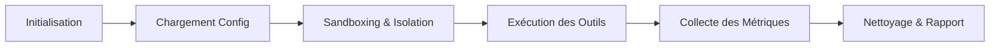

###### README.md >> markdown

<div align="center">

# ⚡ testProjects

**Plateforme d'orchestration, d'automatisation d'outils et d'environnements de test sécurisés.**

[](https://github.com/teremuhamblin/testProjects)
[](#)
[](#04--sécurités)
[](#)

</div>

---

<details>
<summary><b>📂 Cliquez pour déplier / replier le sommaire</b></summary>

<br>

| # | Section | Cible |
|---|---|---|
| 01 | [🎯 Vision](#01--vision) | Orchestration & automatisation |
| 02 | [✨ Fonctions](#02--fonctions) | Tableau de bord des outils |
| 03 | [🏗 Flux](#03--flux) | Composants & cycle de vie |
| 04 | [🛡 Sécurités](#04--sécurités) | Isolation système |
| 05 | [🚀 Main](#05--main) | Cloner, installer, lancer |
| 06 | [🎨 Thèmes](#06--thèmes) | Visuel |
| 07 | [📁 Project](#07--project) | Sources |

</details>

---

## 01 🎯 Vision
> **Cible :** Orchestration & automatisation

Le projet **testProjects** a pour vocation de centraliser, coordonner et exécuter un ensemble hétérogène d'outils et de suites de tests au sein d'un environnement unifié.

- **Orchestration modulaire :** Enchaînement déterministe de scénarios de tests, d'analyses et de tâches techniques sans intervention manuelle.
- **Automatisation continue :** Standardisation des pipelines d'exécution pour éliminer les dérives de configuration entre les environnements.
- **Reproductibilité :** Garantie que chaque routine produit des résultats traçables et comparables dans le temps.

---

## 02 ✨ Fonctions
> **Cible :** Tableau de bord des outils

La solution expose une interface de commande et de supervision permettant de piloter l'ensemble des modules embarqués :

| Module / Outil | Catégorie | Rôle & Action | Statut |
|---|---|---|:---:|
| `runner-engine` | Moteur principal | Planification et dispatch des jobs | En ligne |
| `sec-audit` | Sécurité / Contrôle | Analyse statique et audit des configurations | En ligne |
| `bench-suite` | Performance | Mesures de charges et métriques de latence | En ligne |
| `log-collector` | Télémétrie | Centralisation et formatage des flux de logs | En ligne |

---

## 03 🏗 Flux
> **Cible :** Composants & cycle de vie

Chaque exécution suit un cycle de vie contrôlé afin de préserver l'intégrité du système hôte et la précision des mesures :



- Initialisation : Validation des prérequis et des variables d'environnement.
- Setup Sandbox : Montage des contextes temporaires et des dépendances isolées.
- Dispatch & Exécution : Exécution séquentielle ou parallèle des routines.
- Post-Processing : Agrégation des sorties standards, parsing et génération des artéfacts.
- Teardown : Purge des fichiers volatils et libération des ressources.

## 04 🛡 Sécurités
> **Cible :** Isolation système
- La sécurité opérationnelle est intégrée dès la conception :
- Exécution non-privilégiée :
- Interdiction des accès root superflus et confinement des routines au strict périmètre utilisateur nécessaire.
- Isolation des contextes : Recours à des conteneurs éphémères ou des environnements virtuels cloisonnés pour chaque tâche.
- Gestion stricte des secrets : Aucune clé ou donnée sensible en clair dans les sources ; passage par variables d'environnement injectées à la volée.
- Nettoyage automatique : Destruction systématique des états résiduels en fin de cycle pour prévenir toute persistance involontaire.

## 05 🚀 Main
- **Cible :** Cloner, installer, lancer
1. *Prérequis*
git (>= 2.30)
python (>= 3.10) ou runtime conteneurisé (docker)
make ou bash

2. *Cloner le projet*
```bash
git clone https://github.com/teremuhamblin/testProjects.git
cd testProjects
```

3. *Installation*
Créez l'environnement de travail et installez les dépendances :
**Bash**

###### Configuration d'un environnement virtuel
```python
python3 -m venv .venv
source .venv/bin/activate
```

###### Installation des dépendances
```requirements.txt
pip install -r requirements.txt
```

4. Lancement
```bash
# Lancement rapide du point d'entrée
python main.py
```

## 06 🎨 Thèmes
> **Cible :** Visuel
》》 L'affichage est conçu pour maximiser la lisibilité des diagnostics :
- Sorties console colorées : Badges et alertes dynamiques (INFO, WARN, ERROR, SUCCESS) pour une lecture rapide en terminal.
- Palette ergonomique : Contraste optimisé pour les terminaux en mode sombre (Dark Theme) et compatibilité avec les terminaux minimaux (TTY/CI-CD).
- Rapports visuels : Génération de résumés clairs et synthétiques exportables en Markdown ou HTML.

## 07 📁 Project
> **Cible :** Sources
Structure générale du référentiel :
VOIR docs/STRUCTURE.md

<div align="center">
<sub>Maintenu par <a href="https://github.com/teremuhamblin">@teremuhamblin</a></sub>
</div>
```
